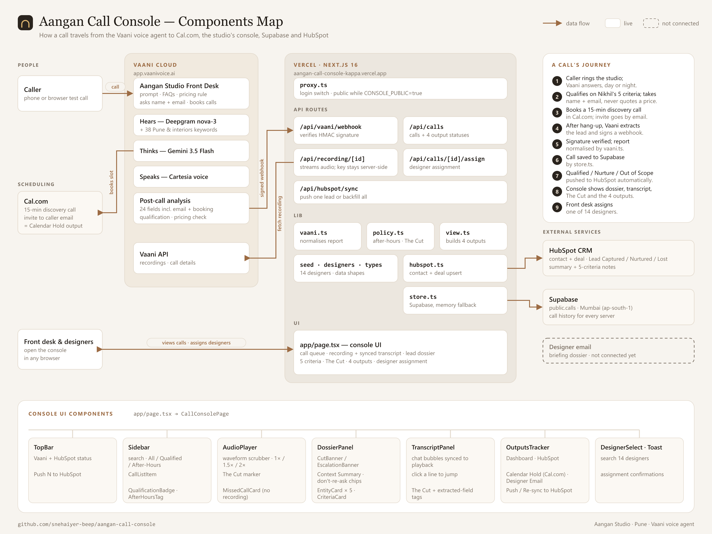

# Aangan Studio — Voice AI Call Console

A front-desk and designer console for **Aangan Studio**, an interior design studio in Pune. The studio gets about 200 inbound calls a month, and a third of them arrive outside 10am–7pm. **Vaani**, a voice AI agent, now answers every call 24/7. It qualifies the caller against the founder's rubric, refuses to quote prices, takes their email, **books a 15-minute discovery call in Cal.com**, and hands this console a structured lead.

**Live:** https://aangan-call-console-kappa.vercel.app



## What it does

- **Call queue:** searchable list with All / Qualified / After-Hours tabs. Badges show the qualification (Qualified, Nurture, Out of Scope, Escalation) and flag calls outside 10am–7pm.
- **Recording and synced transcript:** the player follows the transcript line by line. Click any line to jump to it.
- **Lead dossier:** property and scope, carpet area, budget (only if the caller offered one), location, timeline, an AI summary, and "already captured, don't re-ask" notes for the designer.
- **Nikhil's 5 criteria:** real project, service area, timeline, budget, decision-maker. Each shows pass, fail or unclear, with a reason.
- **"The Cut" pricing guardrail:** detected from the transcript itself. It shows when the agent held policy and turns red if any figure was quoted.
- **4 automation outputs:** Operational Dashboard ✅, HubSpot CRM ✅ (contact with email + deal, stage, pipeline value, notes), Calendar Hold ✅ (booked by Vaani in Cal.com during the call), Designer Email ⏳.
- **Designer assignment** across the 14-person team.

## Architecture

```
Caller ──► Vaani agent (app.vaanivoice.ai) ──► Cal.com (books the 15-min discovery call, invite by email)
              │  signed webhook: call_postprocessing (transcript, summary, entities, dispositions)
              ▼
        Next.js on Vercel ── /api/vaani/webhook (HMAC-SHA256 verified)
              │                    ├─► Supabase  (public.calls — call history)
              │                    └─► HubSpot   (contact + deal, auto-push)
              └── Console UI (app/page.tsx) ◄── /api/calls
                   recordings streamed via /api/recording/[id] (Vaani key stays server-side)
```

| Path | Purpose |
| --- | --- |
| `app/page.tsx` | Console UI (React, Tailwind, Lucide) |
| `app/api/vaani/webhook` | Receives Vaani events and verifies `X-Webhook-Signature` |
| `app/api/calls`, `app/api/calls/[id]/assign` | List calls, assign a designer |
| `app/api/hubspot/sync` | Push one lead, or backfill all |
| `app/api/recording/[id]` | Recording proxy, so the API key never reaches the browser |
| `lib/vaani.ts` | Maps Vaani's payload to the console's `CallLead` |
| `lib/hubspot.ts` | Contact + deal upsert. Re-pushing updates the same deal, never duplicates. |
| `lib/store.ts` | Supabase store, with an in-memory fallback for local dev |
| `lib/policy.ts` | After-hours rules and pricing-guardrail detection |
| `vaani/agent-config.json` | Agent definition: prompt, FAQ, greeting, speech keywords, post-call extraction |
| `lib/seed.ts` | 20 anonymised Sept 2026 enquiries, scored on the rubric. Hidden unless `SHOW_SEED_CALLS=true`. |
| `supabase/schema.sql` | Database table |
| `scripts/` | Create/update the Vaani agent, send a signed test webhook, re-import a call from Vaani |

**Cal.com** is connected inside Vaani (Settings → Integrations → Cal.com, with the event type for the discovery call). The agent asks every new caller for an email, reads it back, and for qualified callers checks availability, books a slot and confirms it before the call ends.

The agent's knowledge comes from the studio's own documents:
- `services.md`: what the studio does and where.
- `qualified.md`: Nikhil's 5-criteria rubric.
- `pricing.md`: never quote a price; only the approved pricing line.

## Run locally

```bash
npm install
cp .env.example .env.local   # fill in the values below
npm run dev                  # http://localhost:3100
```

| Variable | What it's for |
| --- | --- |
| `VAANI_API_KEY`, `VAANI_AGENT_ID` | Vaani API (agent setup, recordings, call re-import) |
| `VAANI_WEBHOOK_SECRET` | Must match the Secret in Vaani → Settings → Webhooks |
| `HUBSPOT_ACCESS_TOKEN` | HubSpot service key: contacts and deals, read and write |
| `HUBSPOT_PIPELINE_ID`, `HUBSPOT_STAGE_*` | Which pipeline and stages deals land in |
| `SUPABASE_URL`, `SUPABASE_SECRET_KEY` | Database. Run `supabase/schema.sql` once. |
| `CONSOLE_USER`, `CONSOLE_PASSWORD`, `CONSOLE_PUBLIC` | Basic-auth login. Set `CONSOLE_PUBLIC=true` to disable it. |
| `SHOW_SEED_CALLS` | `true` shows the Sept 2026 example calls |

All of these are server-only. Never prefix one with `NEXT_PUBLIC_`, and never commit `.env.local`.

**Useful scripts**

```bash
node scripts/send-test-webhook.mjs [baseUrl]         # signed fake call (kept out of HubSpot)
node scripts/import-vaani-call.mjs <call_id> [url]   # pull a real call from Vaani if a webhook was missed
node scripts/update-vaani-persona.mjs                # push prompt / keyword changes to the agent
node scripts/update-vaani-analysis.mjs               # push post-call extraction changes
```

## Not built yet

- **Designer Email** (output 3) shows as *Not connected*.
- **Calendar Hold** status comes from Vaani's post-call extraction (`booking_status`, `booking_time`) — i.e. what the booking tool confirmed on the call — not from Cal.com's API.
- **Phone number:** the agent is tested from Vaani's in-browser test calls. A real number needs Vaani's Set Up Telephony.
- **Designer roster:** 4 real names (Pooja Kulkarni, Amit Shinde, Tanvi Joshi, Aryan); the other 10 are placeholders.
